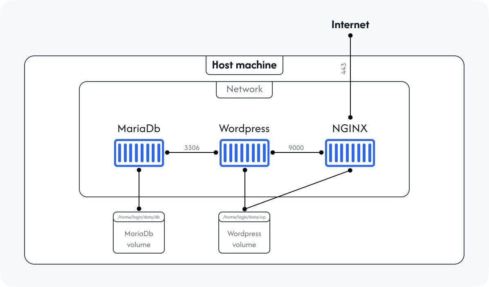

## *This project has been created as part of the 42 curriculum by **wngambi**.*

  

---

## 📖 Description

**Inception** is a system administration project that aims to build a multi-service infrastructure using Docker.

Each service runs inside its own dedicated container, built from its own Docker image. The services communicate with each other through a dedicated Docker network, while Docker volumes ensure persistent data storage.

The main goal of this project is to understand and implement:

- Docker images and containers.
- Docker Compose and service orchestration.
- Docker networks and inter-container communication.
- Persistent volumes and data management.
- Environment variables and configuration.
- Service isolation, security and container management.

## 🏗️ Project Architecture

The infrastructure is orchestrated using **Docker Compose** and consists of several interconnected services:

| Service | Role |
|:---|:---|
| **NGINX** | Web server and reverse proxy, handling HTTPS connections. |
| **WordPress** | Content Management System (CMS), running with PHP-FPM. |
| **MariaDB** | Relational database used to store WordPress data. |
| **Redis** | In-memory cache used to improve WordPress performance. |

All services communicate through a dedicated Docker network.

Persistent volumes are used to store application and database data independently of the containers' lifecycle.

## 🚀 Instructions

### Launch the project

All the instructions required to configure, start, stop and manage the infrastructure are available in the user documentation:

➡️ **[Read the USER_DOC.md](./USER_DOC.md)**

## 📚 Resources

Throughout this project, I used several resources to understand the technologies involved and build the infrastructure.

### Docker

- [Learn Docker – Nicely Dev](https://www.youtube.com/watch?v=EfIed-cFms4&list=PLpLG--nxBMd-wO_MAWh3gzqCcFh4qNMvP)

### NGINX

- [IT-Connect – Florian](https://www.youtube.com/watch?v=gZ6uwd2ki4s&t=1168s)

### Redis

- [ByteByteGo – Redis Explained](https://www.youtube.com/watch?v=z_NbVtbgBJw&t=45s)

### MariaDB / MySQL

- [EvoluNoob – Learn MySQL](https://www.youtube.com/watch?v=3KwmNNucIjA&list=PLYvLkgD4HTGc)

### Inception project overview

- [Inception Tutorial – Cluzet](https://inception.cluzet.fr/)

### AI-assisted learning

I also used AI tools such as **ChatGPT** and **Claude** as learning and development assistants, mainly to help me understand, configure and debug the Bash scripts used to initialize the different services.